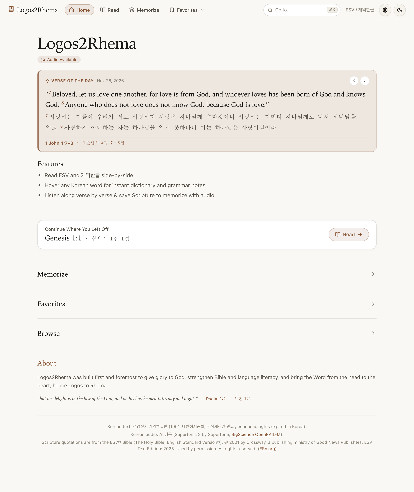

<div align="center">

# Logos2Rhema

**Bilingual Bible reader (`ESV` · `개역한글`) for reading, listening, and learning Korean side-by-side.**

### [Open Live App → logos2rhema.juyoung-m-yoo.workers.dev](https://logos2rhema.juyoung-m-yoo.workers.dev/)

[](https://logos2rhema.juyoung-m-yoo.workers.dev/)


<br />



</div>

---

## Features

- **Side-by-Side Scripture** — Read English (**ESV®** via Crossway's live ESV API) and bundled Korean (**개역한글**, KRV 1961) stacked verse by verse, flip stack order (`EN / 한` ↔ `한 / EN`), and practice recall with hover-to-reveal **Study Mode** blur.
- **Verse of the Day & Memorize** — Daily rotating bilingual **Verse of the Day** card on Home with previous/next day browsing, plus a `#/memorize` view displaying English (`ESV®`) and Korean (`개역한글`) side-by-side (all at once or one-at-a-time flashcard mode) with inline **Supertonic 3** Korean verse audio, multi-verse ranges, and curated starter packs.
- **Instant Korean Dictionary & Grammar** — Hover or tap any Korean word for morphological analysis, **Revised Romanization**, **Web Speech (`ko-KR`)** pronunciation, and a chapter-synced **Words & Grammar** panel.
- **Verse-Synced Audio** — Listen to **Supertonic 3 (`Daniel`)** AI-generated Korean narration (`개역한글 · AI 낭독`) synced verse by verse (two-way scroll follow, preset and custom `0.1x–2.0x` playback speed, `±10s` skip) alongside **Crossway ESV** English audio.
- **Integrated Commentary** — Switch between **Tyndale Open Study Notes** and **Matthew Henry Commentary** synced to your active verse, with keyword/verse search and book/chapter introductions.
- **Fast Navigation & Personalization** — Jump via bilingual references (`John 3:16`, `요 3:16`, `시 23`), browse **Scripture**, **Genres**, **Audio**, **Dictionary**, and **Commentary** directly from Home, save **Bookmarks** and **Highlights**, drag and snap back desktop side rails, and choose Paper, Sepia, or Dark themes, system English and Korean (`Serif` / `Sans`) fonts, and `S`–`XL` text scaling.

## Keyboard Shortcuts

| Shortcut        | Action                                                          |
| :-------------- | :-------------------------------------------------------------- |
| `⌘K` / `Ctrl+K` | Open or close the passage quick-jump modal                      |
| `⌘H` / `Ctrl+H` | Highlight or remove highlight on selected verse text            |
| `←` / `→`       | Skip audio `±10s` while playing, or switch chapters when paused |

## Tech Stack

| Layer                  | Technology                                                                                                                                                                                   |
| :--------------------- | :------------------------------------------------------------------------------------------------------------------------------------------------------------------------------------------- |
| **Frontend**           | [React 19](https://react.dev/), custom editorial CSS (`Paper` / `Sepia` / `Dark`)                                                                                                            |
| **Edge API**           | [Cloudflare Workers](https://workers.cloudflare.com/) (Web Fetch API)                                                                                                                        |
| **Language & Tooling** | [TypeScript](https://www.typescriptlang.org/), [Bun](https://bun.sh/) (`bun build`, `bun test`, `bun fmt`, `bun check`), [Wrangler](https://developers.cloudflare.com/workers/wrangler/)     |
| **Data & Audio**       | Bundled KRV 1961 JSON & Korean lexicon (`public/data/`), live [ESV API](https://api.esv.org/) text & audio, [HelloAO](https://bible.helloao.org/) commentaries, Supertonic 3 AI Korean audio |

## Quick Start

```bash
bun install
cp .dev.vars.example .dev.vars   # add your free ESV_API_KEY from api.esv.org
bun run dev
```

Bundled Korean Scripture (`public/data/bibles/krv/`), Korean lexicon, and HelloAO commentaries work out of the box; English ESV text and audio stream live from Crossway's API using `ESV_API_KEY` (or from gitignored `.cache/esv-local/` in local `bun run dev` when `data-sources/esv.spb` is present and `USE_LIVE_ESV` is unset).

### Scripts

| Command                             | Description                                           |
| :---------------------------------- | :---------------------------------------------------- |
| `bun run dev`                       | Start dev server with HMR and local Worker API        |
| `bun test`                          | Run unit, Worker API, and React tests                 |
| `bun run check`                     | Check formatting and TypeScript types                 |
| `bun run format`                    | Format codebase                                       |
| `bun run build`                     | Typecheck and build client bundle into `dist/client/` |
| `bun run deploy`                    | Deploy to Cloudflare Workers via Wrangler             |
| `bun run data:build`                | Rebuild bundled KRV chapters and Korean lexicon       |
| `bun run audio:generate-krv`        | Generate Supertonic 3 KRV audio and verse timings     |
| `bun run audio:generate-krv:remote` | Offload KRV audio generation to Thunder Compute       |
| `bun run audio:upload-krv`          | Upload KRV MP3s to Cloudflare R2 via Wrangler         |

## Licensing & Attribution

See [THIRD_PARTY_NOTICES.md](THIRD_PARTY_NOTICES.md) for full details, upstream links, and build-time modifications:

- **성경전서 개역한글판 (KRV 1961)** (`public/data/bibles/krv/`) — Attributed to **대한성서공회** (Korean Bible Society). Economic rights (저작재산권) expired in South Korea on December 31, 2011; moral rights (성명표시권 · 동일성유지권) are respected via attribution and verbatim text rendering. _(Note: U.S. URAA restoration rules under 17 U.S.C. § 104A may technically apply to foreign works protected in 1996.)_
- **Supertonic 3 AI Audio** (`logos-krv-audio` R2 & `public/data/timings/krv-supertonic/`) — Synthesized with **Supertonic 3** by Supertone (runtime/SDK: **MIT**; model weights: **BigScience OpenRAIL-M**). Clearly disclosed as AI-generated narration (`개역한글 · AI 낭독`) across API responses, audio players, and page footers.
- **Crossway ESV® Text & Audio** — Streamed live under Crossway's non-commercial ESV API terms with bounded in-memory caching and attribution (`ESV.org`).
- **Commentaries (HelloAO)** — **Tyndale Open Study Notes** (CC BY-SA 4.0) and **Matthew Henry's Complete Commentary** (Public Domain).
- **Bundled Korean Lexicon** (`public/data/lexicon.json`) — Compiled from **KRDICT** (국립국어원, CC BY-SA 2.0 KR), **Korean Wiktionary via Kaikki.org** (CC BY-SA 4.0 / GFDL), and **Kengdic** (MPL 2.0 / LGPL 2.0+).
